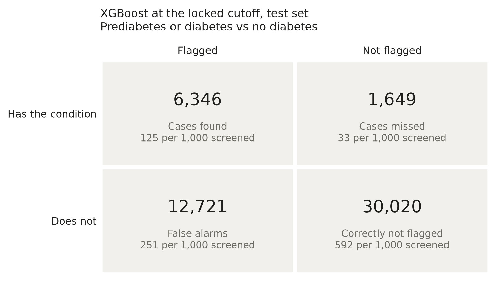
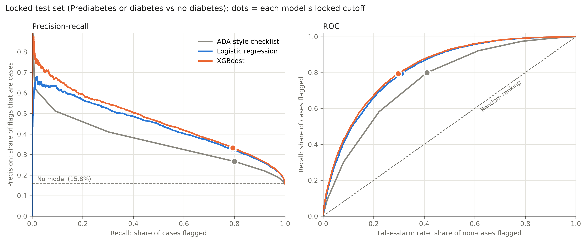
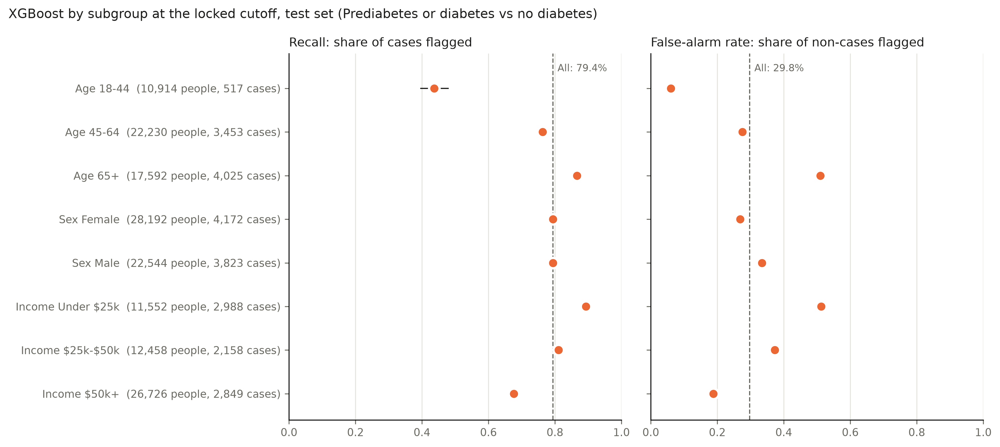

# Stage 7: the locked threshold and the final test results

Stage 7 asks two things: where to set the cutoff for a screening tool that should miss few cases, and how the chosen model does on data it has never seen. We answered them in that order. The cutoff was fixed on training rows only, written to `threshold.json`, and only then were the 20% of rows held back since stage 5 scored, once, at that cutoff.

Results are in `reports/modeling/combined/threshold/` and `.../evaluation/` (main endpoint), and the same folders under `reports/modeling/prediabetes/` (sensitivity analysis).

**The short version.** On the 50,736 locked test rows, XGBoost at the locked cutoff caught **79.4%** of people with diabetes or prediabetes (95% CI 78.5–80.3%) and flagged 37.6% of everyone; a third of the people it flagged had the condition. Test PR-AUC was 0.465 and ROC-AUC 0.826, in line with the validation folds (0.461 and 0.826), and its predicted risks stayed well calibrated (slope 0.99). For the same number of cases found, it raised about **96 fewer false alarms per 1,000 people** than the paper risk checklist clinics use. It is much better at finding diagnosed diabetes (81% caught) than prediabetes (65%), and the cases it misses look, on paper, like people without the condition: ordinary BMI, good reported health, often younger. Its sensitivity drops to 44% for adults under 45 and 68% for incomes of $50k or more.

## How to run it

After `train` (see [training](training.md)), two commands with a deliberate pause between them:

```bash
# 1. Training rows only: choose and save the cutoff
diabetes-screening-model threshold \
  --input data/derived/combined_BRFSS2015.csv \
  --provenance data/derived/combined_BRFSS2015.provenance.json \
  --split reports/modeling/combined/split \
  --training reports/modeling/combined/training \
  --output reports/modeling/combined/threshold

# 2. The locked test set, once, at that cutoff
diabetes-screening-model test \
  --input data/derived/combined_BRFSS2015.csv \
  --provenance data/derived/combined_BRFSS2015.provenance.json \
  --split reports/modeling/combined/split \
  --training reports/modeling/combined/training \
  --threshold reports/modeling/combined/threshold \
  --source data/raw/archive.zip \
  --output reports/modeling/combined/evaluation
```

`threshold` takes a few minutes; `test` a few more, mostly for the 1,000 bootstrap resamples of each of three models. `--source` is optional: with the original three-class file it also splits the results into prediabetes and diagnosed diabetes. For the sensitivity analysis, swap `combined` for `prediabetes`.

`test` refuses to run unless `threshold.json` exists and records the same input file, the same split and the same model file (by SHA-256) that it is about to use. As in earlier stages, every command checks its input against the provenance file and refuses to write into an existing folder.

## 1. Choosing the cutoff (training rows only)

**The target.** The plan asked for a minimum sensitivity, stated in advance: flag at least **80% of people with the condition**, and among the cutoffs that do, take the highest one, because it flags the fewest people. Stage 6 already compared all models at this target, so it is the obvious operating point.

**Predictions to choose it on.** A cutoff chosen on the same rows a model was fitted on is too optimistic, so we used out-of-fold predictions: the saved XGBoost pipeline was refitted five times, each time on four of the five stage 5 folds, and scored the fifth. Every training row thus has a risk from a model that never saw it. These reproduce stage 6 (mean fold PR-AUC 0.4609 against stage 6's 0.4610; logistic regression matches to four decimals, and the last-digit XGBoost difference is most likely floating-point arithmetic differing between the Linux machine that ran stage 6 and the Windows machine that ran stage 7).

**The locked cutoff: 0.1530.** Anyone whose predicted risk is 15.3% or more is flagged. On the out-of-fold predictions that catches 80.0% of cases, flags 38.0% of people, and 33.2% of those flagged have the condition.

What the alternatives would have cost (out-of-fold, per 1,000 people screened, of whom about 158 have the condition). They are shown for the report only; none was used:

| Rule | Cutoff | Flagged | Cases found | Cases missed | False alarms |
| --- | --- | --- | --- | --- | --- |
| Catch 70% of cases | 0.209 | 294 | 110 | 47 | 184 |
| Catch 75% | 0.181 | 334 | 118 | 39 | 216 |
| **Catch 80% (locked)** | **0.153** | **380** | **126** | **32** | **254** |
| Catch 85% | 0.122 | 438 | 134 | 24 | 304 |
| Catch 90% | 0.090 | 510 | 142 | 16 | 368 |
| Best F2 | 0.125 | 432 | 133 | 24 | 299 |

Each extra five points of sensitivity costs roughly 40 to 70 more people flagged per 1,000, and the price rises the higher you go. The best-F2 cutoff happens to sit at about 85% sensitivity here.

**Calibration.** The rule, written into the code before the run: recalibrate (Platt scaling) only if the calibration slope falls outside 0.9–1.1 or the calibration-in-the-large intercept is further than 0.1 from zero. XGBoost's out-of-fold slope was 0.992 and its intercept 0.000, so its risks are used as they are. That is the payoff of leaving the classes unweighted in stage 5. Recalibration would not have changed who gets flagged anyway, because it never changes the order of people's risks.

**Reference models.** Logistic regression got its own cutoff by the same rule (0.1434). The paper checklist uses its own published line, 5 or more points. Both are scored on the test set for context only.

`threshold.json` records the cutoff, the rule, the hashes of the input, split and model file, and the validation numbers. Running `threshold` again gives a byte-identical file, which shows the cutoff is a function of the training rows alone.

## 2. Final results on the locked test set

The 50,736 test rows (7,995 positive) were scored at the cutoffs saved in `threshold.json`. Intervals are 95% bootstrap percentile intervals from 1,000 resamples of the test respondents, with the cutoff held fixed.

| Model | Recall (sensitivity) | Precision | Specificity | F2 | Share flagged | PR-AUC | ROC-AUC |
| --- | --- | --- | --- | --- | --- | --- | --- |
| **XGBoost (selected)** | **0.794** (0.785–0.803) | **0.333** (0.326–0.339) | **0.702** (0.698–0.707) | **0.622** | **0.376** | **0.465** (0.454–0.476) | **0.826** (0.821–0.830) |
| Logistic regression | 0.794 (0.785–0.803) | 0.324 (0.317–0.331) | 0.690 (0.686–0.694) | 0.615 | 0.386 | 0.442 (0.431–0.453) | 0.819 (0.814–0.824) |
| Paper checklist, 5+ points | 0.800 (0.791–0.809) | 0.267 (0.261–0.272) | 0.589 (0.584–0.593) | 0.571 | 0.473 | 0.325 (0.317–0.334) | 0.756 (0.750–0.761) |

The test numbers match the validation numbers closely (recall 79.4% against 80.0%, share flagged 37.6% against 38.0%, PR-AUC 0.465 against 0.461), so the cutoff carried over to new respondents and the earlier work was not overfitted to the folds. Recall landing a little under 80% is expected: the cutoff was set to catch 80% of the *training* cases, and a fresh sample varies around that.

**In plain numbers, per 1,000 people screened** (about 158 of whom have diabetes or prediabetes):

| | Flagged | Cases found | Cases missed | False alarms | Flags that are cases |
| --- | --- | --- | --- | --- | --- |
| XGBoost | 376 | 125 | 33 | 251 | 33% |
| Logistic regression | 386 | 125 | 33 | 261 | 32% |
| Paper checklist | 473 | 126 | 32 | 347 | 27% |



So the model and the checklist find the same number of cases, but the model sends about 96 fewer people per 1,000 for follow-up testing. That is the practical gain from modeling. Logistic regression gets about 90% of that gain with a model that is easier to explain line by line.



**Calibration on the test set.** Observed rate 15.8%, mean predicted risk 15.7%, Brier score 0.105, calibration slope 0.991, intercept 0.002. A person told "your estimated risk is 30%" is, on average, in a group where about 30% have the condition ([reliability chart](../reports/modeling/combined/evaluation/calibration_test.png)).

## 3. Who the model serves less well

Recall and false-alarm rate by subgroup, at the same cutoff (Wilson 95% intervals; counts are cases in the test set):

| Group | Cases | Recall | False-alarm rate |
| --- | --- | --- | --- |
| Age 18–44 | 517 | **0.437** (0.395–0.480) | 0.061 |
| Age 45–64 | 3,453 | 0.763 (0.748–0.776) | 0.275 |
| Age 65+ | 4,025 | 0.866 (0.855–0.876) | 0.510 |
| Female | 4,172 | 0.794 (0.781–0.806) | 0.269 |
| Male | 3,823 | 0.794 (0.780–0.806) | 0.335 |
| Income under $25k | 2,988 | 0.894 (0.882–0.904) | 0.512 |
| Income $25k–$50k | 2,158 | 0.811 (0.794–0.827) | 0.373 |
| Income $50k+ | 2,849 | **0.676** (0.659–0.693) | 0.188 |



One cutoff does not mean one trade-off. Age and BMI push risk up so strongly that for adults under 45 the cutoff behaves like a cautious test: few false alarms (6%), but fewer than half of the cases found. For people over 65 or with low incomes it flips: most cases are found, but about half of the people without the condition are flagged too. Men and women are caught at the same rate, though men get more false alarms. If the tool were used in a younger or wealthier population, its sensitivity would be well below 80%. Group-specific cutoffs could even this out, but they would have to be chosen on training data and justified, so we leave them as future work.

## 4. The false negatives: who is missed and why

The model misses 1,649 of the 7,995 test cases. Their answers look much more like those of people without the condition than like the cases it catches:

| Average answer | Caught cases | **Missed cases** | People without the condition |
| --- | --- | --- | --- |
| Predicted risk | 0.395 | **0.087** | 0.125 |
| BMI | 32.8 | **27.5** | 27.7 |
| Fair or poor general health | 48% | **9%** | 13% |
| High blood pressure | 83% | **38%** | 37% |
| High cholesterol | 74% | **40%** | 38% |
| Difficulty walking | 43% | **9%** | 13% |
| Aged under 45 | 4% | **18%** | 24% |
| Aged 65+ | 55% | **33%** | 32% |

On paper, the missed cases look like the average person without the condition: the same BMI (27.5 against 27.7) and about the same rates of high blood pressure and cholesterol, and on general health and walking they look healthier. They are also younger than the cases the model catches (18% under 45, against 4%). The model leans on BMI, general health, age, blood pressure and cholesterol (stage 6), so a case with ordinary answers on all five is invisible to it. No cutoff fixes this without flagging far more people: catching 90% would mean flagging about 51% of everyone.

**Prediabetes is missed more than diabetes.** With the original survey classes:

| Original class | Test rows | Flagged |
| --- | --- | --- |
| No diabetes | 42,741 | 29.8% (false alarms) |
| Prediabetes | 906 | **64.7%** (61.5–67.7%) |
| Diabetes | 7,089 | **81.3%** (80.3–82.1%) |

Prediabetes is 11% of the cases but 19% of the misses (320 of 1,649). That matters, because prediabetes is the group a screening tool exists for: people with diagnosed diabetes already know. Two likely reasons, which this data can't separate: a diagnosis of diabetes tends to come with diagnoses of high blood pressure and cholesterol and with poorer reported health, all of which the model rewards; and prediabetes is a milder state, so its answers differ less from everyone else's.

## 5. Prediabetes only (sensitivity analysis)

Same code and rules on the cohort without diagnosed diabetes (43,667 test rows, 926 with prediabetes, 2.1%). The cutoff locked on training rows was 0.0172.

| Model | Recall | Precision | Specificity | Share flagged | PR-AUC | ROC-AUC |
| --- | --- | --- | --- | --- | --- | --- |
| **XGBoost** | **0.814** (0.788–0.840) | **0.040** (0.037–0.042) | 0.571 | 0.437 | **0.062** (0.056–0.071) | **0.759** (0.745–0.774) |
| Logistic regression | 0.812 (0.786–0.837) | 0.039 | 0.569 | 0.439 | 0.059 | 0.757 |
| Paper checklist, 5+ points | 0.702 (0.672–0.731) | 0.036 | 0.589 | 0.418 | 0.044 | 0.694 |

Per 1,000 people screened (about 21 with prediabetes), XGBoost flags 437 and finds 17, missing 4. The checklist flags a similar 418 people but finds only 15 and misses 6. So here the gain is in cases found rather than false alarms. In both, about 96% of the people flagged do not report prediabetes. Calibration is still good (slope 0.998).

That is the honest headline for early detection. With these self-reported answers, finding 8 in 10 people with prediabetes means sending more than 4 in 10 adults for a blood test. Many of the "false alarms" may well be undiagnosed prediabetes, since most people with prediabetes do not know they have it, so the real precision is probably higher than the survey labels show. We can't check that with this data. The same subgroup pattern appears, more sharply: recall is 45% for adults under 45 (only 89 test cases, so the interval runs from 35% to 55%) and 92% for people over 65, who then face a 71% false-alarm rate.

## Where we departed from the plan

- **Commit order.** The plan said to commit `threshold.json` before scoring the test set, so git history would prove the order. On request, all commits were made at the end instead. The evidence that the cutoff did not depend on the test set is now: (1) `threshold` reads only training rows and the code refuses to release test rows without a matching `threshold.json`; (2) rerunning `threshold` reproduces the file byte for byte; (3) the test manifest records the hash of the `threshold.json` it used.
- **One reproducibility rerun of `test`.** After the first test run we fixed two chart problems: a label with dollar signs that matplotlib rendered as a formula, and a precision axis that flattened the prediabetes curves. The subgroup and confusion charts were redrawn from the saved summary tables. The curve chart needs the predictions, so `test` was run a second time with the same cutoff and model. Every table it wrote matched the first run exactly, and only the charts were taken from it. No cutoff, model or setting was changed after the test set was opened.
- **Reference rows.** Logistic regression and the checklist are scored on the test set as context. The plan only asked for the chosen model.
- **Subgroup cutoffs** were not tuned: one cutoff for everyone, as decided before the run.

## Limitations

- **Self-reported, cross-sectional labels.** The model identifies people who *currently report* diabetes or prediabetes. It does not predict who will develop diabetes, and undiagnosed cases sit among the negatives.
- **Diagnosed diabetes dominates the positives** (88% of cases). Some of what the model learns is the footprint of an existing diagnosis and its treatment, which is why prediabetes is found less often.
- **Healthcare-contact answers** (`HighBP`, `HighChol`, `CholCheck`) help the model partly because they reflect contact with doctors. Stage 6 showed the model without them still beats the checklist, but a tool built on them would work less well for people who rarely see a doctor.
- **Unweighted survey extract.** Shares and rates describe this table, not the US adult population; the subgroup results are especially sensitive to who answered the survey.
- **One survey year.** The test set comes from the same 2015 survey as the training data. Performance on another year, or on lab-confirmed outcomes such as NHANES, is untested.
- This is a research prototype for risk stratification, not a diagnostic or clinical decision tool.
