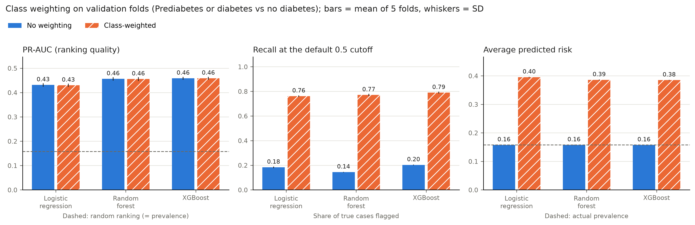

# Stage 5: splitting the data and handling class imbalance

The roadmap asks three things of this stage: a split anyone can reproduce, preprocessing that can't leak information from the test set, and a plan for the class imbalance. This page covers what we built, what we measured along the way, and what stages 6 and 7 need to know.

All numbers come from the committed outputs in `reports/modeling/combined/` (our main endpoint) and `reports/modeling/prediabetes/` (the sensitivity analysis). Stage 1–4 code, reports and docs are left exactly as Sumit wrote them; everything for stages 5 and 6 lives in new files.

**The short version.** We split the data once, 80/20 and stratified, and saved five fixed cross-validation folds inside the training part. The test set stays locked until stage 7 has picked a threshold. The original plan raised two worries, and we tested both. People who gave identical answers turned out to be different people, and they don't inflate the scores, so the split doesn't need to group them. Class weighting didn't make any model better at ranking people; all it did was move the cutoff. So we don't reweight, and stage 7 chooses the cutoff deliberately instead.

## How to run it

Stages 5 and 6 have their own command, `diabetes-screening-model`, so Sumit's `diabetes-screening` command stays untouched. Run `prepare` first (see the README), then:

```bash
diabetes-screening-model split \
  --input data/derived/combined_BRFSS2015.csv \
  --provenance data/derived/combined_BRFSS2015.provenance.json \
  --output outputs/combined/split

diabetes-screening-model imbalance \
  --input data/derived/combined_BRFSS2015.csv \
  --provenance data/derived/combined_BRFSS2015.provenance.json \
  --split outputs/combined/split \
  --output outputs/combined/imbalance
```

`split` takes a few seconds. `imbalance` takes a few minutes on a two-core laptop, almost all of it spent on the random forest; logistic regression needs about 4 seconds for all five folds and XGBoost about 10 (see `timing.csv`). If you're short on time, `--models logistic_regression,xgboost` or `--skip-grouped-check` speed it up. Both commands refuse to run if the input file doesn't match its provenance record, and neither will write into a folder that already exists. `python -m diabetes_screening.modeling ...` works too.

## 1. The split

| | Combined (main) | Prediabetes-only (sensitivity) |
| --- | --- | --- |
| Respondents / positives | 253,680 / 39,977 (15.76%) | 218,334 / 4,631 (2.12%) |
| Training rows (80%) | 202,944, of which 31,982 positive | 174,667, of which 3,705 positive |
| Locked test rows (20%) | 50,736, of which 7,995 positive | 43,667, of which 926 positive |
| Each of the 5 folds | 40,588–40,589 rows, 6,396–6,397 positive | 34,933–34,934 rows, 741 positive |
| Assignment hash | `e8a579495ac8…` | `7632682314c1…` |

The outer split is `train_test_split(stratify=y, random_state=42)`. The folds come from `StratifiedKFold(5, shuffle=True, random_state=42)` run on the training rows only. Because both steps are stratified, the training set, the test set and every fold have the same share of positives to within 0.003 percentage points.

**What gets saved.** `split.json` records the seed, the SHA-256 of the input file, the counts on each side and in each fold, and a hash of the assignment itself. `split_assignment.csv.gz` has one line per respondent: `fold = -1` means test set, and 0 to 4 is the fold of a training row. Neither file contains survey answers, so both are committed. Teammates should load this exact split with `load_split()`, which refuses if the input file or the assignment has changed since it was saved. Treat the committed file as the source of truth rather than re-running `split`, since a different scikit-learn version could shuffle differently. (We ran it twice on our machine and got byte-identical files.)

**Why fix the folds?** Stage 6 tunes three kinds of model and stage 7 searches for a threshold. If all of them use the same five validation folds, every comparison is like for like, even when different people run them.

**The test-set lock.** The only way to get the test rows is `locked_test_data(cohort, plan, "threshold.json")`. It raises `LockedTestSetError` unless `threshold.json` exists and records this split's hash. The roadmap's rule ("choose the threshold on validation data, not test") then becomes something the code enforces, not just something we promise. Every stage 5 and stage 6 manifest records `"test_rows_used": 0`.

## 2. Do identical answers need special treatment?

The stages 5–8 plan suggested keeping respondents with identical answers on the same side of the split, in case repeated rows leaked labels from training into testing. We measured it instead of assuming (`profiles.json` and `grouped_cv_check.csv`):

| | Combined | Prediabetes-only |
| --- | --- | --- |
| Distinct answer profiles | 227,908 | 194,377 |
| Respondents who share their profile with someone | 38,000 (15.0%) | 35,096 (16.1%) |
| Largest group with identical answers | 59 people | 59 people |
| Shared profiles that include **both** outcomes | 1,804 (6,057 people) | 307 (1,123 people) |
| Positive rate: shared vs unique profiles | 6.0% vs 17.5% | 0.9% vs 2.4% |
| Test rows whose profile also appears in training | 13.6% | 14.7% |

These are different people who happened to answer a short, coarse questionnaire the same way. They're not one record entered twice. More than a thousand shared profiles include someone with the condition and someone without it, which a copied record couldn't do. The repeats also cluster among low-risk answers. The biggest group, 59 people, are women aged 45 to 49 in excellent health with a BMI of 21, the top income and education bands, and "no" to every condition. New people screened in real life will share profiles with the training data in exactly the same way, so an ordinary random split gives an honest estimate of real-world performance.

The cross-validation check agrees. On the same training rows, folds that keep identical profiles together score the same as ordinary stratified folds:

| Model (unweighted) | PR-AUC, ordinary folds | PR-AUC, grouped folds | ROC-AUC, ordinary / grouped |
| --- | --- | --- | --- |
| Logistic regression | 0.431 ± 0.007 | 0.431 ± 0.001 | 0.817 / 0.817 |
| Random forest | 0.456 ± 0.007 | 0.455 ± 0.003 | 0.822 / 0.823 |
| XGBoost | 0.458 ± 0.006 | 0.458 ± 0.004 | 0.825 / 0.825 |

For prediabetes-only, the differences are also 0.001 or less. So we used a plain stratified split, which is also what the roadmap describes. `split --group-profiles` is still there if anyone wants to run the grouped version as a sensitivity check.

## 3. Preprocessing inside the pipeline

Each model is a scikit-learn `Pipeline` whose first step is our preprocessor. When a pipeline is fitted on a training fold, the scalers learn their medians, means and spreads from that fold alone. Validation and test rows only ever get transformed.

| Columns | Logistic regression | Tree models | Why |
| --- | --- | --- | --- |
| BMI | `RobustScaler` (median and IQR) | unchanged | The tail runs out to 98 (99th percentile 50); the median and IQR aren't dragged around by extremes |
| MentHlth, PhysHlth | `StandardScaler` | unchanged | 0–30 day counts, mostly zero |
| GenHlth, Age, Education, Income | `StandardScaler`, kept as ordered numbers (stage 6 also tries one column per level) | unchanged | Matches the per-step odds ratios in stage 4 |
| The 14 yes/no answers | unchanged 0/1 | unchanged | Already on a common scale |

Scaling doesn't change what logistic regression can learn. It just puts the coefficients on a similar footing, so the L2 penalty treats every answer fairly. Trees split on thresholds, so rescaling makes no difference to them and they get the raw codes.

There are two feature sets. `full` is all 21 answers. `no-healthcare-contact` drops `CholCheck`, `HighBP`, `HighChol`, `AnyHealthcare` and `NoDocbcCost`, the answers that partly reflect whether someone sees a doctor (see the ascertainment note in [statistics](statistics.md)). The choice is a pipeline setting, so stage 6 can compare both without extra code.

**Where leakage could sneak in, and what stops it**

| Risk | What we did | Checked by |
| --- | --- | --- |
| Test rows influence training, tuning or the threshold | Test rows only come out of `locked_test_data()`, after a matching `threshold.json` exists | `test_test_set_stays_locked_until_threshold_is_saved`; `"test_rows_used": 0` in every manifest |
| Scalers learn from validation rows | Scalers live inside the pipeline, and every fold gets a fresh pipeline | `test_scalers_learn_only_from_the_training_part_of_each_fold`, which plants extreme BMI values in one validation fold and checks the scaler fitted without that fold never sees them |
| Class weights computed from validation labels | Weights are computed from each fold's own training labels | `test_weighting_comparison_and_xgboost_ratio` |
| The split changes quietly, or gets reused on different data | Input hash and assignment hash are checked every time a split is loaded | `test_saved_split_round_trips_and_rejects_edits` |
| Repeated profiles inflate scores | Measured directly (section 2) | `grouped_cv_check.csv` |
| Stage 3 exploration looked at every row, including today's test rows | No features were chosen from the exploration; all 21 answers were fixed in advance | This page |

## 4. Class imbalance

We fitted each model with fixed, untuned settings (stage 6 does the tuning), once with class weighting and once without, on the same five folds. Logistic regression and random forest use `class_weight="balanced"`. XGBoost uses `scale_pos_weight` = negatives / positives, about 5.35 for the combined endpoint and 46 for prediabetes-only. Here are the combined-endpoint results, mean ± SD over folds ([full table](../reports/modeling/combined/imbalance/README.md)):

| Model | Weighting | PR-AUC | ROC-AUC | Brier | Average predicted risk | Recall at 0.5 | Precision at 0.5 |
| --- | --- | --- | --- | --- | --- | --- | --- |
| Logistic regression | none | 0.431 ± 0.007 | 0.817 | 0.109 | 0.158 | 0.183 | 0.552 |
| Logistic regression | balanced | 0.430 ± 0.007 | 0.818 | 0.179 | 0.395 | 0.762 | 0.339 |
| Random forest | none | 0.456 ± 0.007 | 0.822 | 0.106 | 0.158 | 0.144 | 0.611 |
| Random forest | balanced | 0.455 ± 0.007 | 0.823 | 0.172 | 0.386 | 0.771 | 0.339 |
| XGBoost | none | 0.458 ± 0.006 | 0.825 | 0.106 | 0.157 | 0.203 | 0.585 |
| XGBoost | balanced | 0.459 ± 0.006 | 0.825 | 0.176 | 0.385 | 0.790 | 0.335 |

The true share of positives in every fold is 0.158, which is also the PR-AUC you'd get by ranking people at random.



What this shows: weighting doesn't make any model better at telling higher-risk people from lower-risk ones. PR-AUC and ROC-AUC move by 0.001 at most. The weighted and unweighted models put people in almost exactly the same order (Spearman correlation 0.997 to 0.999 in every fold). The weighted model's log-odds are just the unweighted ones shifted up by about 1.6, with little variation (SD 0.12 to 0.15). For logistic regression, theory predicts a pure shift of ln(5.35) = 1.68, which is close.

So weighting behaves like a lower cutoff. Recall at 0.5 jumps from 0.14–0.20 to 0.76–0.79 because many more people get flagged, not because the model learned anything new. The price is the probabilities. Unweighted models predict an average risk of 15.8%, which matches reality, while weighted ones predict about 39%, and the Brier score gets worse (0.11 to 0.17–0.18).

The prediabetes-only results ([table](../reports/modeling/prediabetes/imbalance/README.md)) tell the same story, only more sharply. With just 2.1% positives, the unweighted models flag **nobody** at the 0.5 cutoff. That says the default cutoff is meaningless for rare outcomes, not that the models are useless. Weighting still doesn't improve ranking (PR-AUC 0.054 to 0.057 either way). For the tree models it reshuffles people a little (Spearman about 0.97), and for XGBoost the reshuffle is slightly harmful (ROC-AUC 0.740 weighted against 0.747 unweighted).

The prediabetes signal is weak in general: PR-AUC around 0.055 against a random baseline of 0.021, compared with 0.43–0.46 against 0.158 for the combined endpoint. One likely reason is that the labels themselves are noisy. The [CDC estimates that more than 8 in 10 adults with prediabetes don't know they have it](https://www.cdc.gov/diabetes/communication-resources/prediabetes-statistics.html), so many respondents counted as "no diabetes" are really undiagnosed cases. We think that belongs in the report as a limitation of the data rather than a failure of the models.

**What we decided.** No reweighting by default; the screening priority goes into the threshold instead.

- Stage 6 tunes unweighted models and ranks them by PR-AUC (`scoring="average_precision"`).
- Stage 7 picks the threshold that meets the sensitivity target using out-of-fold predictions on the training rows (`out_of_fold()`), saves it to `threshold.json` with the split hash, and only then unlocks the test set.
- If anyone does use a weighted model, its probabilities have to be recalibrated (isotonic or Platt, fitted inside the folds) before they're read as risks.
- No SMOTE and no undersampling. All 21 answers are whole-number survey codes, and 18 of them are yes/no or ordered categories. SMOTE creates synthetic people by interpolating between neighbours, which would invent answers like `Sex = 0.4` or age band 7.3. SMOTE-NC avoids that, but it adds complexity for no expected gain: there are already 31,982 positives to learn from, and reweighting, which has the same goal, didn't improve ranking at all. Undersampling would throw away about 70% of the negatives and distort the probabilities the same way weighting does.

## 5. How stages 6 and 7 plug in

```python
from sklearn.base import clone
from sklearn.model_selection import RandomizedSearchCV
from diabetes_screening.modeling import load_cohort, load_split, model_factory, out_of_fold, training_data

cohort = load_cohort("data/derived/combined_BRFSS2015.csv",
                     "data/derived/combined_BRFSS2015.provenance.json")
plan = load_split("reports/modeling/combined/split", cohort)  # the committed, shared split
X_train, y_train, folds = training_data(cohort, plan)          # never includes test rows

pipeline = model_factory("xgboost", weighted=False)(y_train)   # preprocessing + model
search = RandomizedSearchCV(pipeline, {"model__max_depth": [3, 4, 5, 6]}, n_iter=4,
                            scoring="average_precision", cv=plan.cv(), random_state=42)
search.fit(X_train, y_train)

# Stage 7: out-of-fold probabilities for choosing the threshold (a fresh pipeline for each fold)
proba, _ = out_of_fold(lambda y: clone(search.best_estimator_), X_train, y_train, folds)
```

`evaluate(y_true, proba, threshold)` computes every metric in one place (PR-AUC, ROC-AUC, Brier, recall, precision, specificity, F2, the 80%-recall operating point and the confusion counts), so all models and stages are scored the same way. Stage 6 itself is described in [training](training.md).

## Where we departed from the plan

`docs/stages-5-8-plan.md` is Sumit's plan for these stages, written before any of this work. We've left it unchanged and record the differences here instead.

- **Endpoint.** Section 0 of the plan assumes prediabetes-only is the main endpoint. The README, the sources page and both stage 1–4 reports later made the combined endpoint the main one, so we follow them and run prediabetes-only as the sensitivity analysis. With the combined endpoint, the test set has 7,995 positives, not the roughly 926 the plan expected.
- **Grouping identical profiles.** The plan proposed a group-aware split. We measured the effect, found none (section 2), and used a plain stratified split. Grouping is still available as an option.
- **Interface.** The plan's `cv_splitter(seed)` became `plan.cv()`, which returns the saved folds, and `make_split` takes the loaded cohort instead of separate `X`, `y` and `groups`.
- **Commands.** The plan mentions adding a `model` command to `diabetes-screening`. To avoid editing Sumit's command-line code, we added a separate `diabetes-screening-model` command instead.

## A check on the official Kaggle file

The README asks whether the official binary file treats prediabetes as negative. We checked it against the Kaggle download ([Diabetes Health Indicators Dataset](https://www.kaggle.com/datasets/alexteboul/diabetes-health-indicators-dataset), `archive.zip`). Its three-class CSV has SHA-256 `a971809d…`, identical to the source in both stage 1–4 provenance files. Row by row, `diabetes_binary_health_indicators_BRFSS2015.csv` has 35,346 positives, and every one of them is existing diabetes; all 4,631 prediabetes respondents are coded 0, despite the file's description. The features are identical to the three-class file. So the roadmap's "about 14%" is really a diabetes-only definition (`--endpoint diabetes-only`), and our combined endpoint is a deliberately different one, as the README already warns.

## Limitations

- The weighting comparison uses fixed, untuned settings. Tuning changes the absolute numbers, but not the mechanism: reweighting shifting everyone's score is a property of reweighting itself, not of these particular settings.
- The folds treat every row as an independent respondent. The extract has no survey weights, strata or clusters, so these metrics describe this table, not the US population.
- Stage 6 tunes hyperparameters and stage 7 will choose a threshold on the same five folds, so out-of-fold scores will be slightly optimistic. The locked test set is the unbiased check, which is why it should be opened only once.
