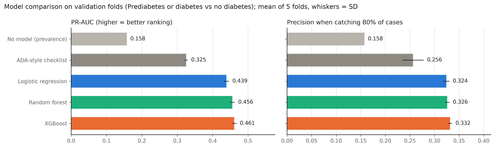
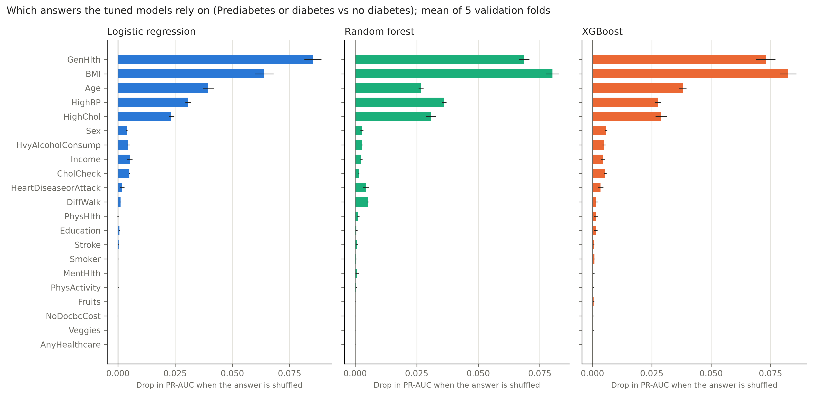
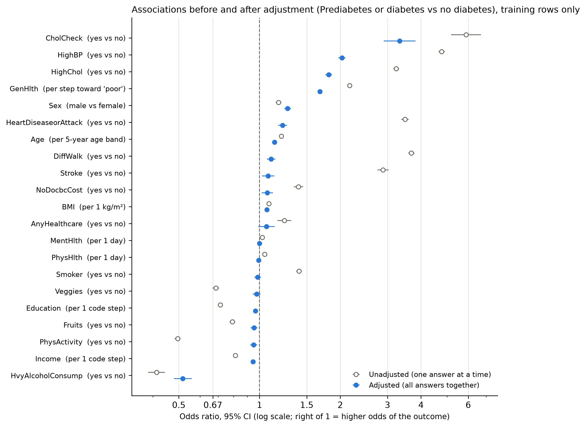

# Stage 6: training and tuning the models

Stage 6 asks for an interpretable baseline first, then a test of whether more flexible models do better. In practice that meant four jobs: tune logistic regression, random forest and XGBoost on the folds saved in stage 5; compare them fairly, against simple yardsticks as well as each other; use statsmodels for proper odds ratios and confidence intervals; and work out which answers the models actually rely on.

Everything here uses the training rows only. The test rows are still locked, and every stage 6 manifest says `"test_rows_used": 0`. Results are in `reports/modeling/combined/training/` (main endpoint) and `reports/modeling/prediabetes/training/` (sensitivity analysis).

**The short version.** All three models clearly beat the clinic-style paper checklist, and the checklist clearly beats guessing. XGBoost came out on top (validation PR-AUC 0.461, against 0.456 for the random forest, 0.439 for logistic regression, 0.325 for the checklist and 0.158 for no model). Its lead over the forest is small but showed up in all five folds, so under the selection rule we fixed in advance, XGBoost goes forward to stage 7. In screening terms: to catch 80% of people with diabetes or prediabetes, the checklist flags about 48% of everyone, while XGBoost flags about 38%. That's roughly 95 fewer false alarms per 1,000 people screened, for the same number of cases found. Five answers carry most of the signal in every model: BMI, general health, age, high blood pressure and high cholesterol.

## How to run it

After `split` (see [splitting](splitting.md)):

```bash
diabetes-screening-model train \
  --input data/derived/combined_BRFSS2015.csv \
  --provenance data/derived/combined_BRFSS2015.provenance.json \
  --split reports/modeling/combined/split \
  --output outputs/combined/training
```

On a two-core laptop, the combined endpoint takes about 20 to 25 minutes in total, and most of that is the random forest search. `--models logistic_regression,xgboost` skips the forest, `--n-iter 4` shrinks every search, and `--skip-importance` drops the permutation importance step. The command writes the comparison tables, charts, tuned settings, a README with the main numbers, and the fitted pipelines (`models/*.joblib`). It also writes `oof_predictions.csv.gz`, the out-of-fold probabilities that stage 7 needs for choosing a threshold. That last file has one row per respondent, so like the cleaned data it stays in your local `outputs/` folder and isn't committed.

## What we compared

**Two yardsticks.** Any model has to beat these before it's worth its complexity.

1. *No model.* Everyone gets the same predicted risk, the share of positives in the training fold. Its PR-AUC equals that share, so it marks the floor.
2. *A paper checklist.* The [Diabetes Risk Test](https://www.niddk.nih.gov/-/media/Files/Health-Information/Health-Professionals/Diabetes/am-i-at-risk/Diabetes-Risk-Test-PDF_508_1.pdf) that NIDDK publishes, adapted from the American Diabetes Association's test, scored from the answers this survey has: age (40–49 = 1 point, 50–59 = 2, 60+ = 3), male = 1, high blood pressure = 1, not physically active = 1, and weight (BMI 25–29.9 = 1, 30–39.9 = 2, 40+ = 3; the paper chart's weight bands work out to these BMI cut points). Five or more points means "increased risk". The survey has no questions on family history or gestational diabetes, which are worth a point each on paper, so our version tops out at 9 instead of 10. The plan suggested a simple rule such as "high blood pressure and age 60+"; we used this checklist instead because clinics actually use it, which makes it a fairer bar.

**Three tuned models.** All three are unweighted (see [splitting](splitting.md), section 4), so their probabilities can be read as risks. Each search is a `RandomizedSearchCV` over the five saved folds (`cv=plan.cv()`), ranked by PR-AUC (`average_precision`), with a fixed random seed. The winning settings are then refitted on all the training rows.

| Model | Settings tried | Candidates |
| --- | --- | --- |
| Logistic regression (L2) | `C` from 0.001 to 100 (log scale); ordinal answers either as ordered numbers or one column per level | 12 |
| Random forest | 200 or 300 trees; maximum depth 12, 20 or unlimited; at least 10, 20, 50 or 100 people per leaf; 4 or 6 answers considered per split | 8 |
| XGBoost | 200 to 800 trees; learning rate 0.02 to 0.2 (log scale); depth 3 to 6; minimum child weight 1 to 25; row sampling 0.7 to 1.0; column sampling 0.6 to 1.0; L2 penalty 0.5 to 20 | 16 |

Random search finds good settings with far fewer tries than a full grid when only a few settings really matter ([Bergstra and Bengio, 2012](https://www.jmlr.org/papers/v13/bergstra12a.html)). The candidate counts reflect what a two-core laptop can do in reasonable time; the random forest gets the fewest because each fit is the slowest. We left XGBoost's `scale_pos_weight` out of the search, although the plan listed it, because stage 5 showed it only shifts the cutoff.

**Metrics.** PR-AUC is the main one: it measures how well a model ranks people with the condition above people without it, and unlike accuracy it isn't flattered by the large majority of negatives. We also report ROC-AUC, the Brier score (how close predicted risks are to what actually happened), and what we call the 80%-recall operating point. That point answers a practical screening question: if we lower the cutoff until 80% of real cases are flagged, how precise is the list of flagged people, what share of people without the condition are correctly left alone, and how many people get flagged altogether? The 80% target is the example in the plan; stage 7 will settle the real target. We also report the best F2 score over all cutoffs, which weights recall four times as heavily as precision.

**How we picked one model.** We wrote this rule down before the full run:

1. Start from the model with the best mean PR-AUC across the five folds.
2. If logistic regression isn't significantly worse than that model, choose logistic regression, because it's the easiest to explain.
3. Otherwise, among the models that aren't significantly worse than the best one, choose the one with the lowest Brier score, because stage 7 will read its probabilities as risks.

"Significantly worse" means p < 0.05 in Nadeau and Bengio's corrected resampled t-test on the five fold-by-fold differences in PR-AUC ([Nadeau and Bengio, 2003](https://link.springer.com/article/10.1023/A:1024068626366)). A plain paired t-test would be overconfident here, because any two folds share three quarters of their training rows, so their scores aren't independent. The correction inflates the variance by 1/5 + 1/4. With only five folds, the test is cautious: it needs a gap that's consistent from fold to fold before it calls it real.

## Results: combined endpoint

### How the models compare

Mean ± SD over the five validation folds ([full table](../reports/modeling/combined/training/README.md)):

| Model | PR-AUC | ROC-AUC | Brier | Precision at 80% recall | Specificity at 80% recall | Share flagged at 80% recall |
| --- | --- | --- | --- | --- | --- | --- |
| No model | 0.158 | 0.500 | 0.133 | 0.158 | 0.000 | 1.000 |
| Paper checklist | 0.325 ± 0.004 | 0.756 | (not a risk) | 0.256 ± 0.022 | 0.544 | 0.514 |
| Logistic regression | 0.439 ± 0.007 | 0.819 | 0.108 | 0.324 ± 0.006 | 0.688 | 0.389 |
| Random forest | 0.456 ± 0.007 | 0.822 | 0.106 | 0.326 ± 0.005 | 0.690 | 0.387 |
| **XGBoost** | **0.461 ± 0.006** | **0.826** | **0.106** | **0.332 ± 0.004** | **0.698** | **0.380** |



Used the way clinics use it (5 or more points), the checklist catches 80.2% of cases, flags 47.7% of people, and 26.5% of the people it flags actually have the condition. XGBoost, at the cutoff that catches the same 80% of cases, flags 38.0% of people and 33.2% of its flags are right. Per 1,000 people screened (about 158 with the condition), both approaches find roughly 126 cases. The checklist raises about 350 false alarms along the way, XGBoost about 255.

The checklist's numbers "at 80% recall" in the table are a little noisier (SD 0.022) because it only has ten possible scores, so its cutoff can't land exactly on 80%. That's also why we show it at its own 5-point cutoff.

All three tuned models predict an average risk of 15.8%, matching the real share of positives, and their Brier scores (about 0.106) are much better than the 0.133 of the no-model baseline. That's what we wanted from leaving the classes unweighted.

### Is the winner really better?

The fold-by-fold gaps in PR-AUC, with the corrected t-test (`paired_differences.csv`):

| Comparison | Mean gain | Folds won | Corrected p |
| --- | --- | --- | --- |
| Logistic regression vs checklist | +0.114 | 5 of 5 | < 0.001 |
| Random forest vs logistic regression | +0.017 | 5 of 5 | < 0.001 |
| XGBoost vs logistic regression | +0.022 | 5 of 5 | < 0.001 |
| XGBoost vs random forest | +0.005 | 5 of 5 | 0.005 |

So the rule's second step (fall back to logistic regression if it's not significantly worse) didn't apply: logistic regression is behind in every fold. XGBoost is ahead of the forest in every fold too, so no tie-break was needed. **XGBoost goes forward to stage 7.**

It's worth keeping the size of these gaps in perspective. Going from the checklist to any model is a big step (+0.11 to +0.14 PR-AUC). Going from logistic regression to XGBoost is a small one (+0.022), and at the 80%-recall operating point the three models are within 1 percentage point of each other on precision. If stage 7 or the report needs a model that's easy to explain line by line, logistic regression gives up very little.

### Tuned settings

| Model | Best settings | Search PR-AUC (best / worst candidate) |
| --- | --- | --- |
| Logistic regression | ordinal answers one-hot encoded, `C` = 3.47 | 0.439 / 0.428 |
| Random forest | 200 trees, depth 12, at least 10 per leaf, 6 answers per split | 0.456 / 0.453 |
| XGBoost | 800 trees, depth 3, learning rate 0.058, min child weight 25, row sampling 0.71, column sampling 0.64, L2 penalty 6.8 | 0.461 / 0.440 |

A few things stand out. For logistic regression, one column per level mattered more than the penalty: all the one-hot candidates with `C` above 0.04 score about 0.439, and all the "ordered number" candidates about 0.431 across the `C` values tried. That suggests risk doesn't rise in equal steps from one age band or general-health level to the next. XGBoost preferred many shallow trees (depth 3) with a slow learning rate. The random forest barely moved between candidates (0.453 to 0.456), so its search budget wasn't a constraint. In every case, refitting the winning settings fold by fold reproduced the search score exactly.

### Without the healthcare-contact answers

We refitted each tuned model without `CholCheck`, `HighBP`, `HighChol`, `AnyHealthcare` and `NoDocbcCost`, keeping the same settings and folds:

| Model | All 21 answers | Without those 5 | Drop |
| --- | --- | --- | --- |
| Logistic regression | 0.439 | 0.409 | 0.030 |
| Random forest | 0.456 | 0.427 | 0.029 |
| XGBoost | 0.461 | 0.431 | 0.030 |

Every model loses about 0.03 PR-AUC, in all five folds, but the reduced models are still far ahead of the checklist (0.325). So the models don't stand or fall on whether someone has seen a doctor, although those answers do help. Most of the lost signal comes from high blood pressure and high cholesterol (see the importance chart below), which are real risk factors as well as signs of medical contact. We'd keep the full model as the main one and mention the reduced model in the report as a check.

### What the models rely on

Permutation importance measures how much validation PR-AUC drops when we shuffle one answer and leave the rest alone, averaged over the five folds:

| Answer | Logistic regression | Random forest | XGBoost |
| --- | --- | --- | --- |
| General health | 0.085 | 0.069 | 0.073 |
| BMI | 0.064 | 0.080 | 0.082 |
| Age band | 0.040 | 0.027 | 0.038 |
| High blood pressure | 0.031 | 0.036 | 0.028 |
| High cholesterol | 0.023 | 0.031 | 0.029 |
| Any other answer | 0.005 or less | 0.005 or less | 0.006 or less |

The three models agree on the same five answers, in a similar order. Logistic regression leans a bit more on general health; the tree models lean a bit more on BMI, probably because they can pick up its uneven effect without help. Everything else matters very little once these five are known. That includes the answers with big unadjusted odds ratios, such as difficulty walking, stroke and heart disease, which fits the odds-ratio results below. The cholesterol-check answer has a large odds ratio but low importance, because almost everyone (96%) says yes, so shuffling it changes few people's scores.



### Odds ratios: what changes once everything is held fixed

The tuned models are built to predict, not to explain, so for interpretation we also fitted one ordinary logistic regression with all 21 answers in statsmodels (training rows only, McFadden pseudo-R² 0.21). We then compared each adjusted odds ratio with the one-answer-at-a-time version (`odds_ratios.csv`).



The strongest adjusted associations are a "yes" to having had a cholesterol check (OR 3.33), high blood pressure (2.03), high cholesterol (1.81), and each step worse in general health (1.68 per step). BMI also matters (1.064 per kg/m², which works out to about 1.86 for 10 extra units), along with being male (1.27) and each older age band (1.14). The cholesterol-check result is the clearest sign of the ascertainment problem noted in stage 4: people who've been diagnosed get their cholesterol checked, and people who see a doctor are the ones who get diagnosed.

The Simpson's-paradox check is the interesting part. Several associations that look strong on their own shrink a lot, vanish or flip once the other answers are held fixed:

- **Physical-health days reverse** (1.045 per day unadjusted, 0.993 adjusted). People with many bad physical-health days also tend to report poor general health and difficulty walking (Spearman correlations 0.45 and 0.42 in the training rows). Once those are accounted for, the extra days add nothing and lean very slightly the other way. Bad days obviously don't protect anyone; the raw association was mostly carried by general health.
- **Smoking, vegetables and mental-health days lose their association** (smoking 1.40 to 0.98, vegetables 0.69 to 0.98). In the training rows, smokers are older on average, more often men (49% against 40%) and twice as likely to report heart disease (13% against 6%). People who eat vegetables daily report higher incomes and better general health. Those differences account for the raw associations.
- **Stroke, heart disease and difficulty walking shrink sharply** (from 2.9–3.7 to 1.1–1.2). They share causes with diabetes (age, weight, blood pressure, cholesterol), and some are consequences of it.
- **Education, income, fruit and exercise move most of the way to 1** (for example, exercise 0.50 to 0.95). The protective-looking pattern mostly runs through BMI, general health and age.
- **Heavy drinking stays "protective"** (0.41 to 0.52). We don't read that as a benefit. Heavy drinkers in the survey are a little younger, which explains part of it. For the rest, a likely explanation is reverse causation: people who've been diagnosed are told to cut down, and heavy drinkers who become ill tend to quit, which moves them out of this group.

None of these are causal estimates; they're associations in a cross-sectional, unweighted survey. But they're a useful warning for the report: single-variable comparisons from stages 3 and 4 can overstate or even flip once age, weight and general health are accounted for.

**Collinearity isn't a problem.** The plan worried that age, income, education and general health overlap. The largest variance inflation factor is 1.79 (general health), and every answer is below 2, well short of the usual warning level of 5.

## Results: prediabetes only (sensitivity analysis)

Same code, same budgets, on the cohort that excludes people who already have diabetes (2.1% positive). Full tables are in the [prediabetes training README](../reports/modeling/prediabetes/training/README.md).

| Model | PR-AUC | ROC-AUC | Precision at 80% recall | Share flagged at 80% recall |
| --- | --- | --- | --- | --- |
| No model | 0.021 | 0.500 | 0.021 | 1.000 |
| Paper checklist | 0.040 ± 0.002 | 0.691 | 0.029 | 0.621 |
| Logistic regression | 0.055 ± 0.003 | 0.749 | 0.039 | 0.440 |
| Random forest | 0.058 ± 0.003 | 0.751 | 0.038 | 0.444 |
| XGBoost | 0.060 ± 0.004 | 0.757 | 0.039 | 0.438 |

The ranking is the same as for the combined endpoint, and the rule again picks XGBoost. This time it took the third step: the random forest isn't significantly worse (corrected p = 0.36, and it won 1 of 5 folds), so the tie went to the lower Brier score. Logistic regression is significantly behind XGBoost (p = 0.003), although the gap is only 0.005.

In practical terms, though, prediabetes alone is a weak screening target with these answers. To catch 80% of cases, every model has to flag about 44% of people, and only about 4% of the people flagged actually report prediabetes. The checklist, used at its 5-point cutoff, catches 71% of cases while flagging 42% of people (3.6% of them correctly). So the models only improve on the checklist a little here. That matches what stage 5 suggested: many people with prediabetes don't know it, so a good share of the "negatives" are probably undiagnosed cases, and no model can learn a clean boundary from labels like that.

Without the five healthcare-contact answers, PR-AUC drops by about 0.005 for each model (roughly a tenth of the signal), again in all five folds.

The odds ratios tell a similar story to the combined endpoint, with two differences worth mentioning. **Stroke reverses** (1.80 unadjusted, 0.84 adjusted, 95% CI 0.72 to 0.97) and **sex only shows up after adjustment** (men 1.02 unadjusted, 1.10 adjusted). The stroke reversal has a plausible selection explanation: this cohort leaves out everyone with diabetes, and someone with a stroke history whose blood sugar is abnormal is more likely to have been diagnosed with diabetes, and so removed, than to be recorded with prediabetes. Removing people based on the outcome can bend associations like this, which is one more reason not to read these odds ratios as causes. Physical-health days reverse here too. The largest variance inflation factor is 1.68, so again there's no collinearity problem.

## Limitations

- The searches are modest (8 to 16 candidates per model), sized for a laptop. A bigger search might gain a little, but stage 5's untuned results were already close to the tuned ones, which suggests the data, not the tuning, sets the ceiling.
- Tuning, model selection and stage 7's threshold all use the same five folds, so the validation numbers here are slightly optimistic. The locked test set is the honest check, which is why it gets opened once, after the threshold is fixed.
- The odds ratios describe associations in an unweighted survey extract. They don't account for the survey design, and they aren't causal: a respondent's answers about blood pressure or cholesterol partly reflect diagnosis and treatment, which happen after contact with a doctor.
- The outcome is self-reported. Identifying people who already report diabetes or prediabetes is not the same as predicting who will develop it.

## Use of AI tools

The stage 6 code (`training.py`, `baselines.py`, `inference.py`, `stage6.py` in `src/diabetes_screening/modeling/`), its tests (`tests/test_training.py`) and this page were drafted with help from an AI assistant (Claude, by Anthropic) during a working session with the team member responsible for stage 6. The selection rule and search spaces were fixed before the full run, and the conclusions above come from the measured results. Before submission, the stage 6 owner should review and run everything, be ready to explain each step, and update this note to describe their own review and changes, as the course's generative-AI policy requires.
