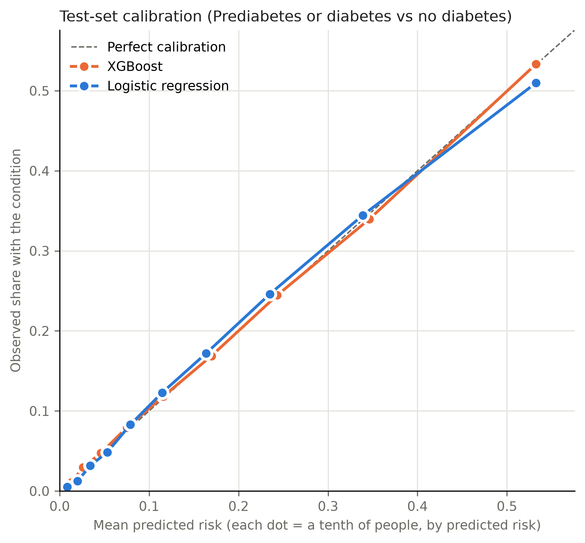

# Stage 7b: final results on the locked test set (Prediabetes or diabetes vs no diabetes)

The 50,736 test rows of split `e8a579495ac8` (7,995 positive) were scored once, at the cutoffs saved in `threshold.json` before any test row was read. Intervals are 95% bootstrap percentile intervals (respondents resampled with replacement, cutoff held fixed).

**XGBoost at the locked cutoff (0.1530)** catches 79.4% of cases (target 80%) and flags 37.6% of people; 33.3% of the people it flags have the condition.

## Headline metrics

Logistic regression and the paper checklist are shown for context only; neither was used to decide anything here. The checklist's "probability" is points / 9, so its Brier score is left out.

| model | cutoff | recall | precision | specificity | f2 | flagged_share | pr_auc | roc_auc |
| --- | --- | --- | --- | --- | --- | --- | --- | --- |
| XGBoost | 0.153 | 0.794 (0.785–0.803) | 0.333 (0.326–0.339) | 0.702 (0.698–0.707) | 0.622 (0.614–0.629) | 0.376 (0.372–0.380) | 0.465 (0.454–0.476) | 0.826 (0.821–0.830) |
| Logistic regression | 0.143 | 0.794 (0.785–0.803) | 0.324 (0.317–0.331) | 0.690 (0.686–0.694) | 0.615 (0.608–0.623) | 0.386 (0.382–0.390) | 0.442 (0.431–0.453) | 0.819 (0.814–0.824) |
| ADA-style checklist | 0.500 | 0.800 (0.791–0.809) | 0.267 (0.261–0.272) | 0.589 (0.584–0.593) | 0.571 (0.564–0.579) | 0.473 (0.468–0.477) | 0.325 (0.317–0.334) | 0.756 (0.750–0.761) |

## Per 1,000 people screened

| model | flagged_per_1000 | cases_per_1000 | cases_found_per_1000 | cases_missed_per_1000 | false_alarms_per_1000 | flags_that_are_cases |
| --- | --- | --- | --- | --- | --- | --- |
| XGBoost | 375.8 | 157.6 | 125.1 | 32.5 | 250.7 | 33.3% |
| Logistic regression | 386.2 | 157.6 | 125.1 | 32.5 | 261.1 | 32.4% |
| ADA-style checklist | 472.6 | 157.6 | 126.0 | 31.5 | 346.5 | 26.7% |

## Calibration on the test set

| model | observed_rate | mean_predicted_risk | brier | calibration_intercept | calibration_slope |
| --- | --- | --- | --- | --- | --- |
| XGBoost | 0.158 | 0.157 | 0.105 | 0.002 | 0.991 |
| Logistic regression | 0.158 | 0.158 | 0.107 | -0.004 | 0.994 |

## Subgroups (selected model, locked cutoff)

Wilson 95% intervals. Counts are shown because small groups give wide intervals.

| group | level | rows | positives | recall | recall_ci_low | recall_ci_high | false_positive_rate | precision |
| --- | --- | --- | --- | --- | --- | --- | --- | --- |
| Age | 18-44 | 10914 | 517 | 0.437 | 0.395 | 0.480 | 0.061 | 0.264 |
| Age | 45-64 | 22230 | 3453 | 0.763 | 0.748 | 0.776 | 0.275 | 0.338 |
| Age | 65+ | 17592 | 4025 | 0.866 | 0.855 | 0.876 | 0.510 | 0.335 |
| Sex | Female | 28192 | 4172 | 0.794 | 0.781 | 0.806 | 0.269 | 0.339 |
| Sex | Male | 22544 | 3823 | 0.794 | 0.780 | 0.806 | 0.335 | 0.326 |
| Income | Under $25k | 11552 | 2988 | 0.894 | 0.882 | 0.904 | 0.512 | 0.378 |
| Income | $25k-$50k | 12458 | 2158 | 0.811 | 0.794 | 0.827 | 0.373 | 0.313 |
| Income | $50k+ | 26726 | 2849 | 0.676 | 0.659 | 0.693 | 0.188 | 0.300 |

## Who the model misses

Average answers of the cases it caught, the cases it missed, and everyone without the condition.

| answer | caught_cases | missed_cases | non_cases |
| --- | --- | --- | --- |
| People | 6,346 | 1,649 | 42,741 |
| Predicted risk (mean) | 0.395 | 0.087 | 0.125 |
| BMI (mean) | 32.832 | 27.530 | 27.726 |
| Obese, BMI 30+ (share) | 0.647 | 0.292 | 0.302 |
| General health fair or poor (share) | 0.477 | 0.092 | 0.134 |
| Age under 45 (share) | 0.036 | 0.176 | 0.243 |
| Age 65+ (share) | 0.549 | 0.326 | 0.317 |
| High blood pressure (share) | 0.833 | 0.375 | 0.371 |
| High cholesterol (share) | 0.736 | 0.400 | 0.379 |
| No physical activity (share) | 0.407 | 0.194 | 0.221 |
| Difficulty walking (share) | 0.432 | 0.092 | 0.131 |
| No cholesterol check in 5 years (share) | 0.003 | 0.026 | 0.042 |
| No health coverage (share) | 0.043 | 0.050 | 0.049 |

Share flagged within each original survey class (for the two positive classes this is recall):

| label | rows | flagged | not_flagged | flagged_share | flagged_share_ci_low | flagged_share_ci_high |
| --- | --- | --- | --- | --- | --- | --- |
| No diabetes | 42741 | 12721 | 30020 | 0.298 | 0.293 | 0.302 |
| Prediabetes | 906 | 586 | 320 | 0.647 | 0.615 | 0.677 |
| Diabetes | 7089 | 5760 | 1329 | 0.813 | 0.803 | 0.821 |
