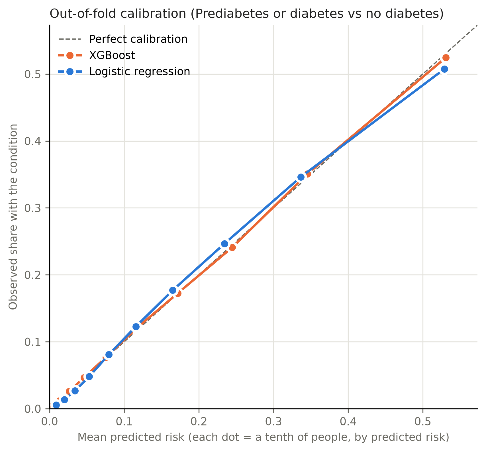

# Stage 7a: the locked cutoff (Prediabetes or diabetes vs no diabetes)

Everything on this page comes from the 202,944 training rows (31,982 positive) and the five saved folds of split `e8a579495ac8`. The 50,736 test rows were not loaded.

**Locked cutoff: 0.1530** on the predicted risk from XGBoost (`xgboost.joblib`, SHA-256 `22aaf6e26196…`). Anyone at or above it is flagged.

Rule: The highest cutoff on the selected model's out-of-fold predicted risks (training rows only) that still flags at least 80% of the training cases. The highest such cutoff flags the fewest people, so it is the cheapest way to meet the target. Fixed before any test row is read.

On the out-of-fold predictions this cutoff catches 80.0% of cases and flags 38.0% of people; 33.2% of the people it flags have the condition. Per 1,000 people screened that is about 380 flagged, 126 cases found, 32 missed and 254 false alarms.

## Other cutoffs (for information only)

What each alternative would cost on the same out-of-fold predictions. Only the locked row is used.

| rule | threshold | recall | precision | specificity | flagged_share | flagged_per_1000 | cases_found_per_1000 | cases_missed_per_1000 | false_alarms_per_1000 |
| --- | --- | --- | --- | --- | --- | --- | --- | --- | --- |
| catch 70% of cases | 0.209 | 0.700 | 0.375 | 0.782 | 0.294 | 294 | 110 | 47 | 184 |
| catch 75% of cases | 0.181 | 0.750 | 0.353 | 0.743 | 0.334 | 334 | 118 | 39 | 216 |
| **catch 80% of cases (locked)** | 0.153 | 0.800 | 0.332 | 0.698 | 0.380 | 380 | 126 | 32 | 254 |
| catch 85% of cases | 0.122 | 0.850 | 0.306 | 0.639 | 0.438 | 438 | 134 | 24 | 304 |
| catch 90% of cases | 0.090 | 0.900 | 0.278 | 0.563 | 0.510 | 510 | 142 | 16 | 368 |
| best F2 | 0.125 | 0.846 | 0.308 | 0.645 | 0.432 | 432 | 133 | 24 | 299 |

## Calibration on the out-of-fold predictions

Rule, fixed before this run: Recalibrate (Platt scaling: a logistic regression of the outcome on the model's out-of-fold log-odds) only if the calibration slope is outside 0.9-1.1 or the calibration-in-the-large intercept is further than 0.1 from 0. Recalibration is monotone, so it never changes who is flagged, only the risk a person is told.

| model | observed_rate | mean_predicted_risk | brier | calibration_intercept | calibration_slope |
| --- | --- | --- | --- | --- | --- |
| XGBoost | 0.158 | 0.158 | 0.106 | 0.000 | 0.992 |
| Logistic regression | 0.158 | 0.158 | 0.108 | 0.000 | 0.998 |

Recalibration: not needed: the selected model's risks already meet the rule, so they are used as they are.

## Check against stage 6

Refitting the saved pipelines fold by fold should reproduce the stage 6 refit check.

| model | oof_pr_auc_now | stage6_refit_check | reproduces |
| --- | --- | --- | --- |
| XGBoost | 0.4609 | 0.4610 | True |
| Logistic regression | 0.4391 | 0.4391 | True |
