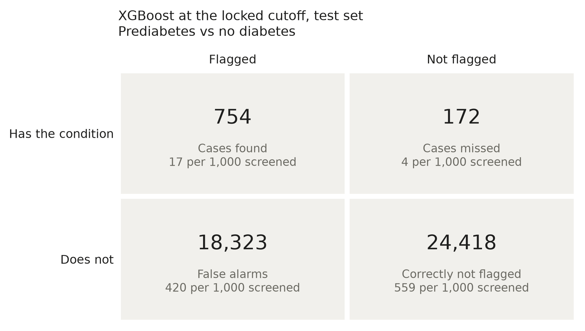
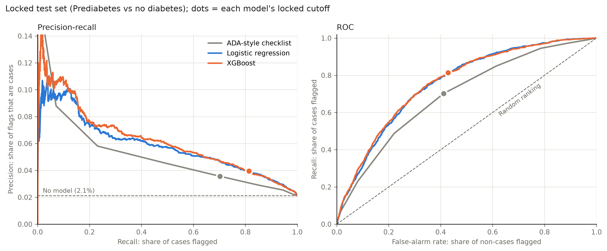
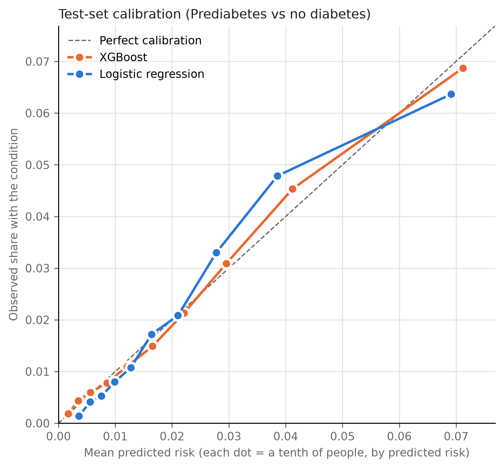
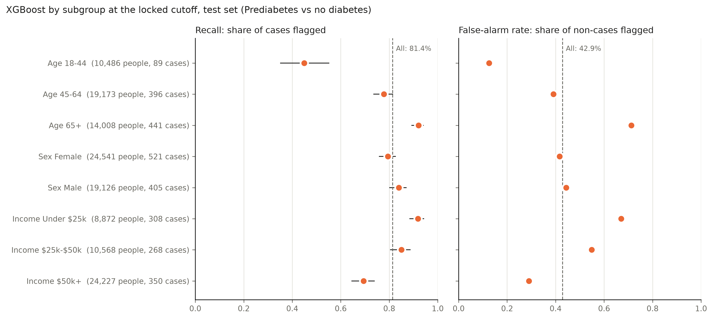

# Stage 7b: final results on the locked test set (Prediabetes vs no diabetes)

The 43,667 test rows of split `7632682314c1` (926 positive) were scored once, at the cutoffs saved in `threshold.json` before any test row was read. Intervals are 95% bootstrap percentile intervals (respondents resampled with replacement, cutoff held fixed).

**XGBoost at the locked cutoff (0.0172)** catches 81.4% of cases (target 80%) and flags 43.7% of people; 4.0% of the people it flags have the condition.

## Headline metrics

Logistic regression and the paper checklist are shown for context only; neither was used to decide anything here. The checklist's "probability" is points / 9, so its Brier score is left out.

| model | cutoff | recall | precision | specificity | f2 | flagged_share | pr_auc | roc_auc |
| --- | --- | --- | --- | --- | --- | --- | --- | --- |
| XGBoost | 0.017 | 0.814 (0.788–0.840) | 0.040 (0.037–0.042) | 0.571 (0.567–0.576) | 0.165 (0.156–0.175) | 0.437 (0.432–0.441) | 0.062 (0.056–0.071) | 0.759 (0.745–0.774) |
| Logistic regression | 0.017 | 0.812 (0.786–0.837) | 0.039 (0.037–0.042) | 0.569 (0.565–0.574) | 0.164 (0.155–0.175) | 0.439 (0.434–0.443) | 0.059 (0.053–0.067) | 0.757 (0.742–0.771) |
| ADA-style checklist | 0.500 | 0.702 (0.672–0.731) | 0.036 (0.033–0.038) | 0.589 (0.584–0.593) | 0.148 (0.139–0.158) | 0.418 (0.413–0.422) | 0.044 (0.039–0.049) | 0.694 (0.678–0.709) |

## Per 1,000 people screened

| model | flagged_per_1000 | cases_per_1000 | cases_found_per_1000 | cases_missed_per_1000 | false_alarms_per_1000 | flags_that_are_cases |
| --- | --- | --- | --- | --- | --- | --- |
| XGBoost | 436.9 | 21.2 | 17.3 | 3.9 | 419.6 | 4.0% |
| Logistic regression | 438.8 | 21.2 | 17.2 | 4.0 | 421.6 | 3.9% |
| ADA-style checklist | 417.5 | 21.2 | 14.9 | 6.3 | 402.6 | 3.6% |

## Calibration on the test set

| model | observed_rate | mean_predicted_risk | brier | calibration_intercept | calibration_slope |
| --- | --- | --- | --- | --- | --- |
| XGBoost | 0.021 | 0.021 | 0.020 | 0.000 | 0.998 |
| Logistic regression | 0.021 | 0.021 | 0.020 | -0.001 | 1.053 |

## Subgroups (selected model, locked cutoff)

Wilson 95% intervals. Counts are shown because small groups give wide intervals.

| group | level | rows | positives | recall | recall_ci_low | recall_ci_high | false_positive_rate | precision |
| --- | --- | --- | --- | --- | --- | --- | --- | --- |
| Age | 18-44 | 10486 | 89 | 0.449 | 0.350 | 0.553 | 0.126 | 0.030 |
| Age | 45-64 | 19173 | 396 | 0.778 | 0.734 | 0.816 | 0.391 | 0.040 |
| Age | 65+ | 14008 | 441 | 0.921 | 0.892 | 0.942 | 0.713 | 0.040 |
| Sex | Female | 24541 | 521 | 0.795 | 0.758 | 0.827 | 0.417 | 0.040 |
| Sex | Male | 19126 | 405 | 0.840 | 0.801 | 0.872 | 0.444 | 0.039 |
| Income | Under $25k | 8872 | 308 | 0.919 | 0.883 | 0.944 | 0.670 | 0.047 |
| Income | $25k-$50k | 10568 | 268 | 0.851 | 0.803 | 0.888 | 0.549 | 0.039 |
| Income | $50k+ | 24227 | 350 | 0.694 | 0.644 | 0.740 | 0.290 | 0.034 |

## Who the model misses

Average answers of the cases it caught, the cases it missed, and everyone without the condition.

| answer | caught_cases | missed_cases | non_cases |
| --- | --- | --- | --- |
| People | 754 | 172 | 42,741 |
| Predicted risk (mean) | 0.050 | 0.010 | 0.021 |
| BMI (mean) | 31.878 | 26.535 | 27.726 |
| Obese, BMI 30+ (share) | 0.593 | 0.244 | 0.302 |
| General health fair or poor (share) | 0.340 | 0.035 | 0.134 |
| Age under 45 (share) | 0.053 | 0.285 | 0.243 |
| Age 65+ (share) | 0.538 | 0.203 | 0.317 |
| High blood pressure (share) | 0.732 | 0.221 | 0.371 |
| High cholesterol (share) | 0.698 | 0.250 | 0.379 |
| No physical activity (share) | 0.361 | 0.198 | 0.221 |
| Difficulty walking (share) | 0.334 | 0.058 | 0.131 |
| No cholesterol check in 5 years (share) | 0.001 | 0.041 | 0.042 |
| No health coverage (share) | 0.061 | 0.058 | 0.049 |

Share flagged within each original survey class (for the two positive classes this is recall):

| label | rows | flagged | not_flagged | flagged_share | flagged_share_ci_low | flagged_share_ci_high |
| --- | --- | --- | --- | --- | --- | --- |
| No diabetes | 42741 | 18323 | 24418 | 0.429 | 0.424 | 0.433 |
| Prediabetes | 926 | 754 | 172 | 0.814 | 0.788 | 0.838 |
