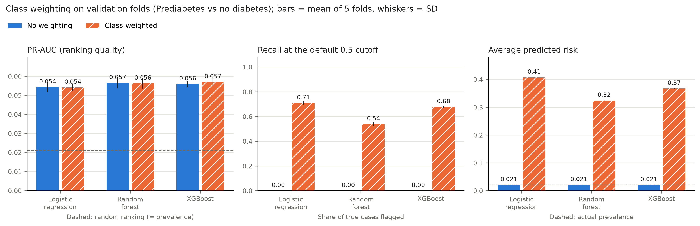

# Stage 5: does class weighting help? (Prediabetes vs no diabetes)

These results use the 174,667 training rows only (3,705 positive, 2.12%). The 43,667 test rows were never loaded. Split `7632682314c1` (stratified, seed 42).

Each number is the mean ± SD over the five validation folds. Recall and precision here use the default 0.5 cutoff, which is only a placeholder; stage 7 picks the real one. For reference, a model that ranks people at random gets a PR-AUC equal to the share of positives.

| model | weighting | pr_auc | roc_auc | brier | mean_predicted_risk | recall | precision |
| --- | --- | --- | --- | --- | --- | --- | --- |
| logistic_regression | unweighted | 0.054 ± 0.003 | 0.749 ± 0.006 | 0.020 ± 0.000 | 0.021 ± 0.000 | 0.000 ± 0.000 | 0.000 ± 0.000 |
| logistic_regression | weighted | 0.054 ± 0.002 | 0.751 ± 0.006 | 0.207 ± 0.001 | 0.407 ± 0.001 | 0.709 ± 0.013 | 0.044 ± 0.001 |
| random_forest | unweighted | 0.057 ± 0.003 | 0.746 ± 0.004 | 0.020 ± 0.000 | 0.021 ± 0.000 | 0.000 ± 0.000 | n/a (none flagged) |
| random_forest | weighted | 0.056 ± 0.003 | 0.746 ± 0.004 | 0.145 ± 0.001 | 0.324 ± 0.001 | 0.539 ± 0.019 | 0.051 ± 0.002 |
| xgboost | unweighted | 0.056 ± 0.002 | 0.747 ± 0.005 | 0.020 ± 0.000 | 0.021 ± 0.000 | 0.000 ± 0.000 | 0.000 |
| xgboost | weighted | 0.057 ± 0.002 | 0.740 ± 0.004 | 0.187 ± 0.001 | 0.367 ± 0.001 | 0.678 ± 0.008 | 0.044 ± 0.000 |

## Does weighting change who ranks as high risk, or just move the cutoff?

Averaged over folds. A Spearman correlation close to 1 means the weighted and unweighted models put people in almost the same order. A small SD in the log-odds shift means weighting simply slides everyone's score up by about the same amount, which is the same as using a lower cutoff.

| model | spearman_weighted_vs_unweighted | mean_logit_shift | sd_logit_shift |
| --- | --- | --- | --- |
| logistic_regression | 0.996 | 3.754 | 0.179 |
| random_forest | 0.972 | 3.444 | 0.323 |
| xgboost | 0.970 | 3.663 | 0.402 |

## Do repeated answer profiles inflate the scores? (unweighted models)

Same training rows, two ways of forming the folds: ordinary stratified folds, and folds that keep everyone with identical answers together. If repeated profiles were leaking labels, the second version would score clearly lower.

| model | cv_folds | pr_auc | roc_auc | brier | pr_auc_drop_vs_plain |
| --- | --- | --- | --- | --- | --- |
| logistic_regression | plain stratified | 0.054 ± 0.003 | 0.749 ± 0.006 | 0.020 ± 0.000 | 0.000 |
| logistic_regression | profile-grouped | 0.054 ± 0.004 | 0.749 ± 0.006 | 0.020 ± 0.000 | 0.000 |
| random_forest | plain stratified | 0.057 ± 0.003 | 0.746 ± 0.004 | 0.020 ± 0.000 | 0.000 |
| random_forest | profile-grouped | 0.057 ± 0.004 | 0.747 ± 0.006 | 0.020 ± 0.000 | -0.001 |
| xgboost | plain stratified | 0.056 ± 0.002 | 0.747 ± 0.005 | 0.020 ± 0.000 | 0.000 |
| xgboost | profile-grouped | 0.055 ± 0.003 | 0.745 ± 0.002 | 0.020 ± 0.000 | 0.001 |

