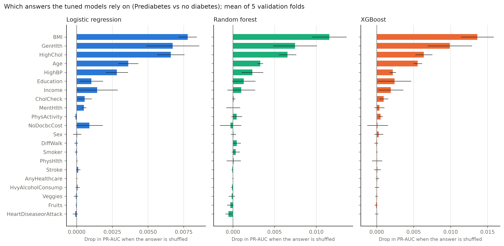
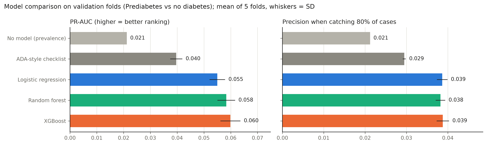
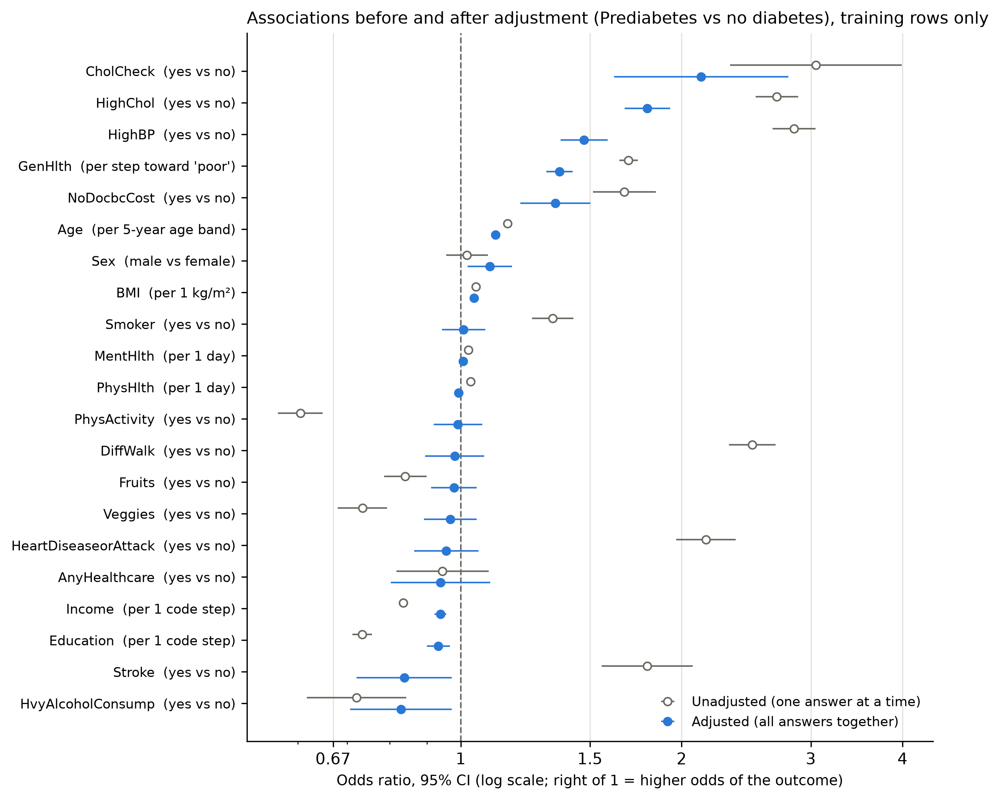

# Stage 6: tuned models (Prediabetes vs no diabetes)

Everything on this page comes from the 174,667 training rows (3,705 positive) and the five saved folds of split `7632682314c1`. The 43,667 test rows were not loaded.

## How the models compare

Mean ± SD over the five validation folds. The `_at_80_recall` columns answer a screening question: if we lower the cutoff until 80% of real cases get flagged, how many of the flagged people actually have the condition (precision), how many people without it are correctly left alone (specificity), and what share of everyone ends up flagged? Ignore the checklist's Brier score: points divided by 9 isn't a risk.

| model | pr_auc | roc_auc | brier | precision_at_80_recall | specificity_at_80_recall | flagged_share_at_80_recall |
| --- | --- | --- | --- | --- | --- | --- |
| No model (prevalence) | 0.021 ± 0.000 | 0.500 ± 0.000 | 0.021 ± 0.000 | 0.021 ± 0.000 | 0.000 ± 0.000 | 1.000 ± 0.000 |
| ADA-style checklist | 0.040 ± 0.002 | 0.691 ± 0.006 | 0.239 ± 0.001 | 0.029 ± 0.000 | 0.384 ± 0.002 | 0.621 ± 0.001 |
| Logistic regression | 0.055 ± 0.003 | 0.749 ± 0.006 | 0.020 ± 0.000 | 0.039 ± 0.001 | 0.568 ± 0.015 | 0.440 ± 0.015 |
| Random forest | 0.058 ± 0.003 | 0.751 ± 0.003 | 0.020 ± 0.000 | 0.038 ± 0.001 | 0.563 ± 0.013 | 0.444 ± 0.013 |
| XGBoost | 0.060 ± 0.004 | 0.757 ± 0.004 | 0.020 ± 0.000 | 0.039 ± 0.001 | 0.570 ± 0.017 | 0.438 ± 0.017 |

The paper checklist used the way clinics use it (5 or more points means increased risk):

| model | recall | precision | specificity | flagged_share |
| --- | --- | --- | --- | --- |
| ADA-style checklist | 0.706 ± 0.009 | 0.036 ± 0.001 | 0.584 ± 0.002 | 0.422 ± 0.002 |

**Chosen for stage 7: XGBoost.** Reason: highest mean validation PR-AUC (0.0599) and the lowest Brier score among the models it can't be told apart from (Random forest).

The rule, written down before the full run: 1) Start from the model with the best mean validation PR-AUC. 2) If logistic regression is not significantly worse than it, take logistic regression, because it is the easiest to explain. 3) Otherwise, among the models that are not significantly worse than the best one, take the one with the lowest mean Brier score, because stage 7 reads its probabilities as risks. 'Significantly worse' means p < 0.05 in Nadeau and Bengio's corrected resampled t-test on the five fold-by-fold PR-AUC differences.

## Fold-by-fold gaps in PR-AUC

All models were scored on the same five folds, so we can compare them fold by fold. `p_value` comes from Nadeau and Bengio's corrected resampled t-test, which allows for the folds sharing most of their training data. With only five folds it's a cautious test.

| model | compared_with | mean_pr_auc_gain | sd_pr_auc_gain | folds_won | folds | corrected_t | p_value |
| --- | --- | --- | --- | --- | --- | --- | --- |
| Logistic regression | ADA-style checklist | 0.015 | 0.004 | 5 | 5 | 5.302 | 0.006 |
| Random forest | ADA-style checklist | 0.019 | 0.005 | 5 | 5 | 5.224 | 0.006 |
| XGBoost | ADA-style checklist | 0.020 | 0.005 | 5 | 5 | 6.040 | 0.004 |
| Random forest | Logistic regression | 0.003 | 0.002 | 5 | 5 | 2.608 | 0.059 |
| XGBoost | Logistic regression | 0.005 | 0.001 | 5 | 5 | 6.479 | 0.003 |
| XGBoost | Random forest | 0.002 | 0.002 | 4 | 5 | 1.032 | 0.360 |

## Without the healthcare-contact answers

Same tuned settings, refitted without CholCheck, HighBP, HighChol, AnyHealthcare and NoDocbcCost. These answers partly reflect whether someone sees a doctor, so it's worth knowing how much the models lean on them.

| model | pr_auc_all_21 | pr_auc_without_contact | mean_drop | sd_drop | folds_where_full_is_better |
| --- | --- | --- | --- | --- | --- |
| Logistic regression | 0.055 | 0.049 | 0.006 | 0.002 | 5 |
| Random forest | 0.058 | 0.054 | 0.004 | 0.003 | 5 |
| XGBoost | 0.060 | 0.055 | 0.005 | 0.003 | 5 |

## Tuned settings

The refit check re-scores the winning settings with a fresh fit on each fold. It should match the search's own score, and it does when the run is reproducible.

- **Logistic regression**: `{"model__C": 0.04662, "preprocess__kind": "linear-onehot"}` (search PR-AUC 0.0550, refit check 0.0550)
- **Random forest**: `{"model__n_estimators": 300, "model__min_samples_leaf": 50, "model__max_features": "sqrt", "model__max_depth": 20}` (search PR-AUC 0.0583, refit check 0.0583)
- **XGBoost**: `{"model__colsample_bytree": 0.84466, "model__learning_rate": 0.02033, "model__max_depth": 3, "model__min_child_weight": 1, "model__n_estimators": 600, "model__reg_lambda": 4.77744, "model__subsample": 0.74185}` (search PR-AUC 0.0599, refit check 0.0599)

## Adjusted odds ratios (statsmodels, training rows only)

Unadjusted means one answer at a time; adjusted means all 21 answers in one ordinary logistic regression. `change_after_adjustment` flags associations that weaken, vanish or reverse once the other answers are held fixed (our Simpson's-paradox check). VIF above about 5 would mean an answer overlaps heavily with the others.

| feature | unit | unadjusted_or | adjusted_or | adjusted_ci_low | adjusted_ci_high | change_after_adjustment | vif |
| --- | --- | --- | --- | --- | --- | --- | --- |
| HighBP | yes vs no | 2.847 | 1.473 | 1.367 | 1.587 | weaker | 1.278 |
| HighChol | yes vs no | 2.697 | 1.796 | 1.673 | 1.929 | weaker | 1.149 |
| CholCheck | yes vs no | 3.048 | 2.126 | 1.618 | 2.795 | weaker | 1.033 |
| BMI | per 1 kg/m² | 1.048 | 1.042 | 1.038 | 1.047 | similar | 1.107 |
| Smoker | yes vs no | 1.334 | 1.009 | 0.943 | 1.081 | no longer clear | 1.095 |
| Stroke | yes vs no | 1.795 | 0.838 | 0.722 | 0.972 | reversed | 1.067 |
| HeartDiseaseorAttack | yes vs no | 2.159 | 0.956 | 0.864 | 1.058 | no longer clear | 1.141 |
| PhysActivity | yes vs no | 0.605 | 0.992 | 0.919 | 1.070 | no longer clear | 1.143 |
| Fruits | yes vs no | 0.840 | 0.979 | 0.912 | 1.051 | no longer clear | 1.116 |
| Veggies | yes vs no | 0.735 | 0.968 | 0.891 | 1.052 | no longer clear | 1.112 |
| HvyAlcoholConsump | yes vs no | 0.721 | 0.829 | 0.707 | 0.972 | weaker | 1.024 |
| AnyHealthcare | yes vs no | 0.944 | 0.938 | 0.803 | 1.097 | unclear either way | 1.121 |
| NoDocbcCost | yes vs no | 1.671 | 1.346 | 1.206 | 1.502 | weaker | 1.144 |
| GenHlth | per step toward 'poor' | 1.693 | 1.363 | 1.308 | 1.421 | weaker | 1.681 |
| MentHlth | per 1 day | 1.025 | 1.007 | 1.003 | 1.012 | weaker | 1.222 |
| PhysHlth | per 1 day | 1.032 | 0.994 | 0.989 | 0.998 | reversed | 1.560 |
| DiffWalk | yes vs no | 2.497 | 0.981 | 0.895 | 1.076 | no longer clear | 1.462 |
| Sex | male vs female | 1.020 | 1.095 | 1.022 | 1.174 | appears only after adjustment | 1.071 |
| Age | per 5-year age band | 1.158 | 1.116 | 1.100 | 1.131 | weaker | 1.340 |
| Education | per 1 code step | 0.734 | 0.932 | 0.899 | 0.966 | weaker | 1.313 |
| Income | per 1 code step | 0.835 | 0.938 | 0.921 | 0.956 | weaker | 1.462 |

## The five answers each model relies on most (permutation importance)

How much validation PR-AUC drops when one answer is shuffled, averaged over the five folds.

| model | feature | pr_auc_drop_mean | pr_auc_drop_sd |
| --- | --- | --- | --- |
| XGBoost | BMI | 0.014 | 0.002 |
| Random forest | BMI | 0.012 | 0.002 |
| XGBoost | GenHlth | 0.010 | 0.003 |
| Logistic regression | BMI | 0.008 | 0.001 |
| Random forest | GenHlth | 0.007 | 0.003 |
| Logistic regression | GenHlth | 0.007 | 0.002 |
| Logistic regression | HighChol | 0.007 | 0.001 |
| Random forest | HighChol | 0.006 | 0.001 |
| XGBoost | HighChol | 0.006 | 0.001 |
| XGBoost | Age | 0.005 | 0.001 |
| Logistic regression | Age | 0.004 | 0.001 |
| Random forest | Age | 0.003 | 0.000 |
| Logistic regression | HighBP | 0.003 | 0.001 |
| XGBoost | Education | 0.002 | 0.002 |
| Random forest | HighBP | 0.002 | 0.001 |

